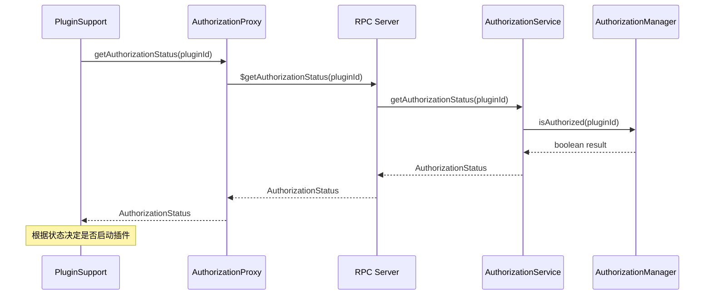
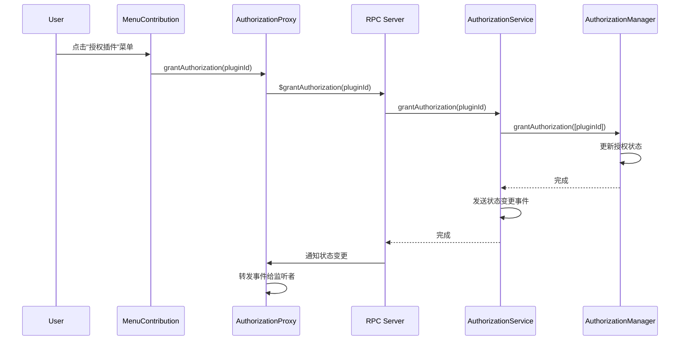
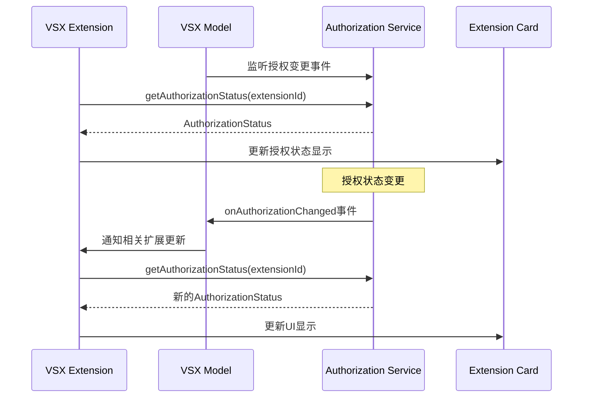
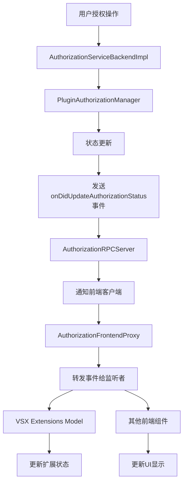
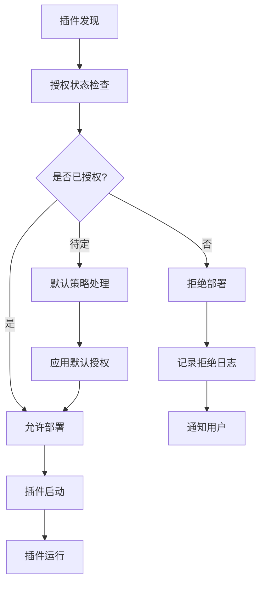

# Theia 插件授权系统详细流程文档

## 概述

Theia 插件授权系统是一个用于管理插件权限和授权状态的安全框架。该系统经过重构，移除了插件间依赖管理功能，专注于核心的插件授权功能。

## 系统架构

### 总体架构图
```
┌─────────────────────────────────────────────────────────────────┐
│                    Theia 插件授权系统                              │
├─────────────────────────────────────────────────────────────────┤
│  Frontend (Browser)          │         Backend (Node.js)        │
├─────────────────────────────────────────────────────────────────┤
│  UI层:                       │  服务层:                          │
│  - 授权菜单贡献               │  - 授权服务后端实现                │
│  - 前端代理                   │  - RPC服务器                      │
│                              │  - 授权管理器                      │
├─────────────────────────────────────────────────────────────────┤
│  通信层:                     │  存储层:                          │
│  - RPC调用                   │  - 授权状态内存存储                │
│  - 事件监听                   │  - 默认授权策略                    │
├─────────────────────────────────────────────────────────────────┤
│                      Common/Shared 层                           │
│  - 接口定义                  - 类型定义                          │
│  - 常量定义                  - 事件类型                          │
└─────────────────────────────────────────────────────────────────┘
```

## 核心组件详解

### 1. 后端服务层 (Backend Node.js)

#### 1.1 插件授权服务后端实现 (`plugin-authorization-service-backend-impl.ts`)
```typescript
@injectable()
export class AuthorizationServiceBackendImpl implements IAuthorizationService {
    // 核心授权检查逻辑
    async getAuthorizationStatus(pluginId: string): Promise<AuthorizationStatus>
    async grantAuthorization(pluginId: string): Promise<void>
    async revokeAuthorization(pluginId: string): Promise<void>
    
    // 事件通知
    onDidUpdateAuthorizationStatus: Event<AuthorizationChangeEvent>
}
```

**职责：**
- 实现核心授权业务逻辑
- 管理授权状态变更
- 提供RPC接口给前端调用
- 发送授权状态变更事件

#### 1.2 授权RPC服务器 (`plugin-authorization-rpc-server.ts`)
```typescript
@injectable()
export class AuthorizationRPCServer {
    // RPC接口实现
    $getAuthorizationStatus(pluginId: string): Promise<AuthorizationStatus>
    $grantAuthorization(pluginId: string): Promise<void>
    $revokeAuthorization(pluginId: string): Promise<void>
    
    // 客户端通知
    setClient(client: AuthorizationClient): void
}
```

**职责：**
- 作为前后端通信的桥梁
- 处理RPC调用和响应
- 管理客户端连接
- 转发事件到前端

#### 1.3 插件授权管理器 (`plugin-authorization-manager.ts`)
```typescript
@injectable()
export class PluginAuthorizationManager {
    // 授权状态管理
    private readonly authorizedPlugins = new Set<string>()
    private readonly deniedPlugins = new Set<string>()
    
    // 策略管理
    isAuthorized(pluginId: string): boolean
    grantAuthorization(pluginIds: string[]): void
    revokeAuthorization(pluginIds: string[]): void
}
```

**职责：**
- 内存中的授权状态管理
- 默认授权策略实现
- 授权决策逻辑
- 状态持久化（未来扩展）

### 2. 前端UI层 (Browser)

#### 2.1 授权前端代理 (`plugin-authorization-frontend-proxy.ts`)
```typescript
@injectable()
export class AuthorizationFrontendProxy implements IAuthorizationService {
    // 代理方法到后端
    async getAuthorizationStatus(pluginId: string): Promise<AuthorizationStatus>
    async grantAuthorization(pluginId: string): Promise<void>
    async revokeAuthorization(pluginId: string): Promise<void>
    
    // 事件转发
    onDidUpdateAuthorizationStatus: Event<AuthorizationChangeEvent>
}
```

**职责：**
- 前端授权服务的代理实现
- 将前端调用转发到后端RPC服务
- 接收后端事件并转发给前端组件
- 缓存授权状态（可选）

#### 2.2 授权菜单贡献 (`plugin-authorization-menu-contribution.ts`)
```typescript
@injectable()
export class AuthorizationMenuContribution implements MenuContribution, CommandContribution {
    // 命令注册
    registerCommands(registry: CommandRegistry): void
    registerMenus(menus: MenuModelRegistry): void
    
    // 授权操作
    private async handleGrantTestPlugin(): Promise<void>
    private async handleRevokeTestPlugin(): Promise<void>
    private async handleResetAuthorization(): Promise<void>
}
```

**职责：**
- 提供授权管理的用户界面
- 注册授权相关的菜单命令
- 处理用户的授权操作请求
- 开发和测试工具

### 3. 通用层 (Common/Shared)

#### 3.1 授权服务接口 (`plugin-i-authorization-service.ts`)
```typescript
export interface IAuthorizationService {
    getAuthorizationStatus(pluginId: string): Promise<AuthorizationStatus>
    grantAuthorization(pluginId: string): Promise<void>
    revokeAuthorization(pluginId: string): Promise<void>
    onDidUpdateAuthorizationStatus: Event<AuthorizationChangeEvent>
}
```

#### 3.2 类型定义 (`types.ts`)
```typescript
export enum AuthorizationStatus {
    GRANTED = 'granted',
    DENIED = 'denied',
    PENDING = 'pending'
}

export interface AuthorizationChangeEvent {
    pluginId: string
    status: AuthorizationStatus
    timestamp: number
}
```

## 详细流程分析

### 4. 插件启动时的授权检查流程



#### 4.1 详细步骤

1. **插件发现阶段**
   - `HostedPluginSupport` 发现待部署的插件
   - 调用 `getAuthorizationStatus(pluginId)` 检查授权状态

2. **前端代理处理**
   - `AuthorizationFrontendProxy` 接收调用
   - 通过RPC通道发送 `$getAuthorizationStatus` 请求到后端

3. **后端服务处理**
   - `AuthorizationRPCServer` 接收RPC调用
   - 委托给 `AuthorizationServiceBackendImpl` 处理

4. **授权决策**
   - `AuthorizationServiceBackendImpl` 调用 `PluginAuthorizationManager`
   - `PluginAuthorizationManager` 根据内部策略返回授权状态

5. **结果返回**
   - 授权状态通过相同路径返回到插件支持服务
   - 根据状态决定插件的部署和启动

### 5. 用户授权操作流程



#### 5.1 详细步骤

1. **用户操作**
   - 用户通过菜单栏的"授权管理"选择授权操作
   - `AuthorizationMenuContribution` 处理用户命令

2. **授权请求**
   - 菜单贡献调用前端代理的授权方法
   - 前端代理通过RPC发送授权请求到后端

3. **状态更新**
   - 后端服务更新授权管理器中的状态
   - 触发状态变更事件

4. **事件通知**
   - 状态变更事件通过RPC发送到前端
   - 前端代理转发事件给所有监听者

5. **UI更新**
   - 相关UI组件接收事件并更新显示状态

### 6. VSX Registry 集成

#### 6.1 VSX Extensions Model 集成

```typescript
// vsx-extensions-model.ts
@inject(PluginAuthorizationProvider)
protected readonly authorizationProvider: PluginAuthorizationProvider;

@inject(IAuthorizationService) 
protected readonly newAuthorizationService: IAuthorizationService;

// 监听授权状态变更
this.authorizationProvider.onAuthorizationChanged(event => {
    this.handleAuthorizationChange(event);
});
```

**职责：**
- 监听插件授权状态变化
- 更新扩展市场中插件的授权状态显示
- 管理扩展的安装和启用权限

#### 6.2 VSX Extension 组件集成

```typescript
// vsx-extension.tsx
protected _authorizationState: 'pending' | 'authorized' | 'unauthorized' = 'pending';

async updateAuthorizationStatus(): Promise<void> {
    const authStatus = await this.newAuthorizationService.getAuthorizationStatus(this.id);
    this._authorized = authStatus === AuthorizationStatus.GRANTED;
    this._authorizationState = authStatus === AuthorizationStatus.GRANTED ? 'authorized' : 'unauthorized';
}
```

**职责：**
- 每个扩展卡片显示授权状态
- 根据授权状态控制安装/启用按钮
- 提供授权状态的视觉反馈

#### 6.3 VSX Registry 授权流程



## 系统配置和依赖注入

### 7. 后端模块配置 (`plugin-ext-backend-module.ts`)

```typescript
export function bindMainBackend(bind: interfaces.Bind, ...) {
    // 新的基于类的授权管理器 (不依赖数据库)
    bind(PluginAuthorizationManager).toSelf().inSingletonScope();
    
    // 新的授权服务后端实现
    bind(AuthorizationServiceBackendImpl).toSelf().inSingletonScope();
    bind(IAuthorizationService).toService(AuthorizationServiceBackendImpl);
    
    // RPC 服务器绑定
    bind(AuthorizationRPCServer).toSelf().inSingletonScope();
    bind(ConnectionHandler).toDynamicValue(ctx => {
        return new RpcConnectionHandler(authorizationServicePath, (client: any) => {
            const rpcServer = ctx.container.get(AuthorizationRPCServer);
            if (rpcServer.setClient) {
                rpcServer.setClient(client);
            }
            return rpcServer;
        });
    }).inSingletonScope();
}
```

### 8. 前端模块配置 (`plugin-ext-frontend-module.ts`)

```typescript
export default new ContainerModule((bind, unbind, isBound, rebind) => {
    // 新的授权服务前端代理
    bind(AuthorizationFrontendProxy).toSelf().inSingletonScope();
    bind(IAuthorizationService).toService(AuthorizationFrontendProxy);
    
    // 新的授权菜单贡献
    bind(AuthorizationMenuContribution).toSelf().inSingletonScope();
    bind(CommandContribution).toService(AuthorizationMenuContribution);
    bind(MenuContribution).toService(AuthorizationMenuContribution);
});
```

## 事件流和生命周期

### 9. 授权状态变更事件流



### 10. 插件生命周期中的授权检查



## 错误处理和容错机制

### 11. 异常情况处理

1. **授权服务不可用**
   - 前端代理实现降级策略
   - 默认允许插件运行（向后兼容）
   - 记录错误日志

2. **RPC通信失败**
   - 自动重试机制
   - 超时处理
   - 缓存最后已知状态

3. **授权状态不一致**
   - 定期状态同步
   - 冲突解决策略
   - 手动重置功能

### 12. 日志和调试

系统在关键节点记录详细的日志信息：

```typescript
// 授权检查日志
console.log(`[AUTH-SERVICE] 🔍 Getting authorization status for: ${pluginId}`);
console.log(`[AUTH-SERVICE] 📊 Status for ${pluginId}: ${status}`);

// RPC调用日志
console.log(`[AUTH-RPC] 📞 RPC call: $getAuthorizationStatus(${pluginId})`);
console.log(`[AUTH-RPC] ✅ RPC response: ${response}`);

// 前端代理日志
console.log(`[AUTH-PROXY] 📞 Delegating getAuthorizationStatus(${pluginId}) to backend...`);
console.log(`[AUTH-PROXY] ✅ getAuthorizationStatus result: ${result}`);
```

## 性能优化和扩展性

### 13. 性能考虑

1. **缓存策略**
   - 前端授权状态缓存
   - 批量授权检查
   - 懒加载授权数据

2. **异步处理**
   - 非阻塞授权检查
   - 异步事件通知
   - 后台状态同步

3. **内存管理**
   - 及时清理事件监听器
   - 限制授权状态缓存大小
   - 垃圾回收友好的数据结构

### 14. 扩展性设计

1. **插件化授权策略**
   - 策略接口抽象
   - 可插拔授权规则
   - 动态策略加载

2. **多租户支持**
   - 用户级别授权
   - 工作空间级别授权
   - 组织级别授权

3. **外部集成**
   - LDAP/Active Directory集成
   - OAuth授权服务器集成
   - 自定义授权服务集成

## 总结

Theia插件授权系统通过清晰的分层架构和模块化设计，提供了一个可靠、可扩展的插件权限管理解决方案。系统的核心特点包括：

1. **安全性**: 默认拒绝策略，显式授权机制
2. **可扩展性**: 模块化设计，支持多种授权策略
3. **用户友好**: 直观的UI界面，清晰的状态显示
4. **性能**: 异步处理，智能缓存，批量操作
5. **可维护性**: 清晰的代码结构，完善的日志记录

该系统为Theia平台的插件生态系统提供了重要的安全保障，确保只有经过授权的插件才能在系统中运行。