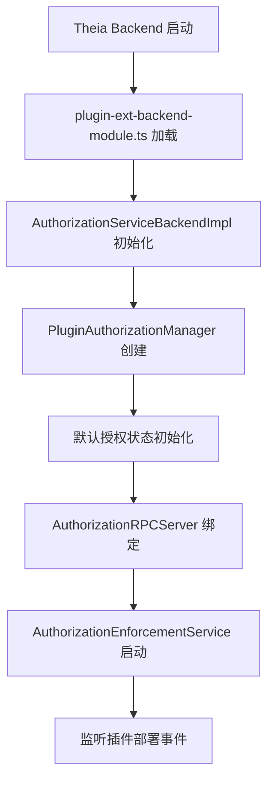
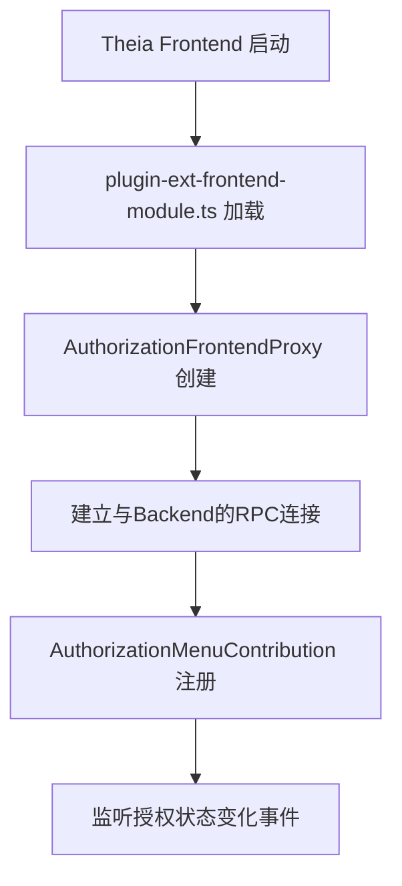
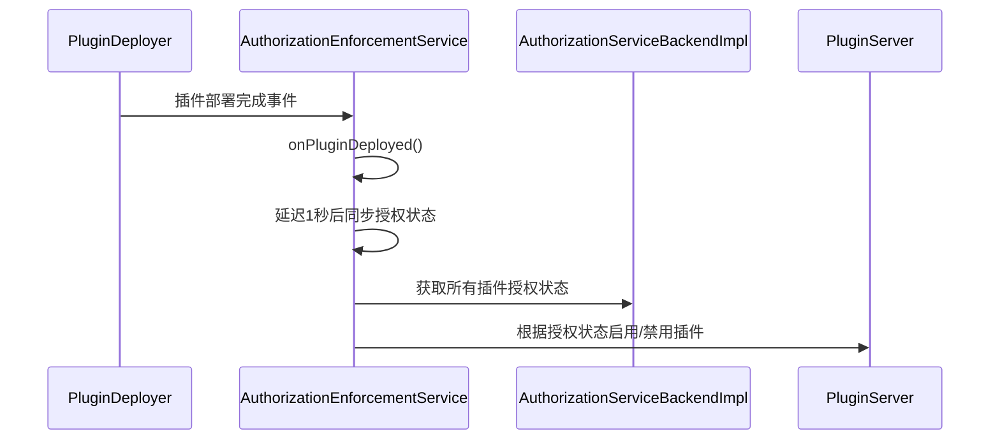
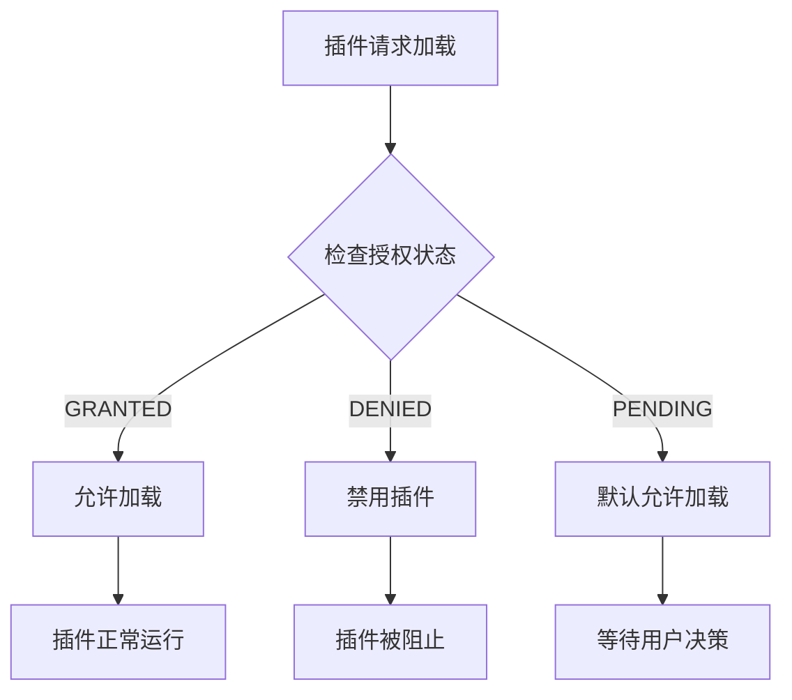
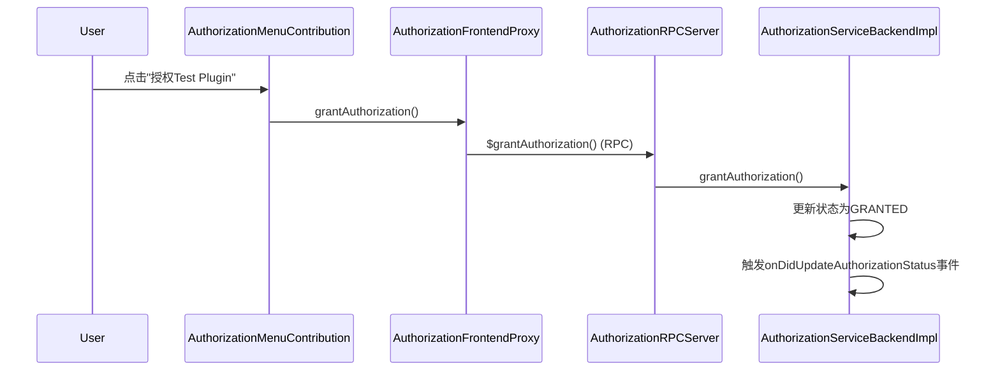
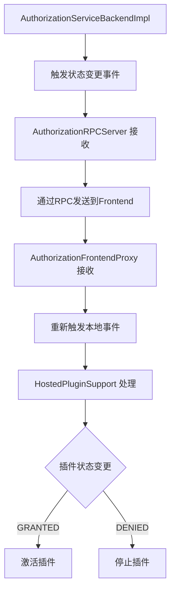

# Theia Plugin 授权系统流程文档

## 概述

Theia 插件授权系统是一个三层架构的复合授权解决方案，旨在控制插件的加载和执行权限。该系统在项目启动时初始化，监听插件状态变化，并动态管理插件的启用/禁用状态。

## 系统架构

### 核心组件层次结构

```
Frontend (browser)                 Backend (node)
├── AuthorizationMenuContribution  ├── AuthorizationServiceBackendImpl (核心服务)
├── AuthorizationFrontendProxy      ├── AuthorizationRPCServer (RPC层)
├── PluginAuthorizationFrontend     ├── PluginAuthorizationProviderImpl (兼容层)
                                   ├── AuthorizationEnforcementService (强制执行)
                                   └── PluginAuthorizationManager (管理器)
```

### 三层抽象架构

1. **兼容层**: `PluginAuthorizationProvider` - 保持与旧API的向后兼容性
2. **服务层**: `IAuthorizationService` - 新的授权服务接口  
3. **管理层**: `PluginAuthorizationManager` - 底层状态管理和持久化

## 启动流程

### 1. 系统初始化阶段

#### Backend 服务启动



**关键代码位置**: `packages/plugin-ext/src/main/node/plugin-ext-backend-module.ts:122-164`

```typescript
// 新的授权服务后端实现
bind(AuthorizationServiceBackendImpl).toSelf().inSingletonScope();
bind(IAuthorizationService).toService(AuthorizationServiceBackendImpl);

// Legacy 插件授权提供者绑定 (保持向后兼容)
bind(PluginAuthorizationProviderImpl).toSelf().inSingletonScope();
bind(PluginAuthorizationProvider).toService(PluginAuthorizationProviderImpl);
```

#### Frontend 服务初始化



**关键代码位置**: `packages/plugin-ext/src/main/browser/plugin-ext-frontend-module.ts:318-325`

### 2. 默认授权状态初始化

**位置**: `packages/plugin-ext/src/main/node/authorization-service-backend-impl.ts:122-137`

系统启动时会初始化以下默认状态：
- 内置插件: `GRANTED` (如 TypeScript、JSON 语言特性)
- Demo 插件: `GRANTED` (测试用途)
- Test 插件: `DENIED` (用于测试授权流程)

```typescript
private initializeDefaultStates(): void {
    // Built-in plugins - always granted
    this.authorizationStates.set('vscode.typescript-language-features', AuthorizationStatus.GRANTED);
    this.authorizationStates.set('vscode.json-language-features', AuthorizationStatus.GRANTED);
    
    // Demo plugins - granted by default
    this.authorizationStates.set('<unpublished>.demo-plugin', AuthorizationStatus.GRANTED);
    this.authorizationStates.set('<unpublished>.theia-webview-test-plugin', AuthorizationStatus.GRANTED);
    
    // Test plugin - starts as denied for testing purposes
    this.authorizationStates.set('<unpublished>.test-plugin', AuthorizationStatus.DENIED);
}
```

## 插件加载检查流程

### 1. 插件部署阶段



**关键代码位置**: `packages/plugin-ext/src/main/node/authorization-enforcement-service.ts:121-129`

### 2. 插件授权检查逻辑



**关键代码位置**: `packages/plugin-ext/src/hosted/browser/hosted-plugin.ts:261-280`

```typescript
protected acceptPlugin(plugin: DeployedPlugin): boolean {
    const isConnectionScoped = isConnectionScopedBackendPlugin(plugin);
    if (!isConnectionScoped) {
        return false;
    }
    
    // Check authorization status synchronously if available
    const pluginId = plugin.metadata.model.id;
    try {
        console.log(`[HostedPluginSupport] 🔍 Checking acceptance for plugin: ${pluginId}`);
        // For now, we'll accept the plugin and let the async authorization check happen later
        return true; // Default to allowing the plugin to load
    } catch (error) {
        console.warn(`[HostedPluginSupport] ⚠️  Failed to check authorization for plugin ${pluginId}:`, error);
        return true; // Default to allowing the plugin to load
    }
}
```

## 授权状态变更流程

### 1. 用户授权操作

通过菜单触发授权变更：



**关键代码位置**: `packages/plugin-ext/src/main/browser/authorization-menu-contribution.ts:98-105`

### 2. 授权状态事件传播



**关键代码位置**: `packages/plugin-ext/src/hosted/browser/hosted-plugin.ts:715-748`

```typescript
protected async handleAuthorizationStatusChange(pluginId: string, status: string): Promise<void> {
    console.log(`[HostedPluginSupport] 🔍 Processing authorization change for plugin ${pluginId}: ${status}`);
    
    if (status === 'granted') {
        // Plugin has been authorized - activate it directly
        console.log(`[HostedPluginSupport] ✅ Activating authorized plugin: ${pluginId}`);
        
        try {
            await this.activatePlugin(pluginId);
            console.log(`[HostedPluginSupport] 🎉 Successfully activated plugin: ${pluginId}`);
        } catch (error) {
            console.error(`[HostedPluginSupport] ❌ Failed to activate plugin ${pluginId}:`, error);
            // Fall back to full reload if direct activation fails
            this.load();
        }
        
    } else if (status === 'denied') {
        // Plugin has been deauthorized - deactivate it
        console.log(`[HostedPluginSupport] 🛑 Deactivating unauthorized plugin: ${pluginId}`);
        
        for (const manager of this.managers.values()) {
            if (manager) {
                await manager.$stop(pluginId);
                console.log(`[HostedPluginSupport] ✅ Stopped plugin ${pluginId} in manager`);
            }
        }
    }
}
```

## 监听机制

### 1. Backend 事件监听

**AuthorizationEnforcementService** 监听两个主要事件：

```typescript
// 监听插件部署事件
this.pluginDeployer.onDidDeploy(() => {
    this.onPluginDeployed();
});

// 监听授权状态变更事件
this.pluginAuthorizationProvider.onAuthorizationChanged(event => {
    this.onAuthorizationChanged(event);
});
```

**位置**: `packages/plugin-ext/src/main/node/authorization-enforcement-service.ts:50-57`

### 2. Frontend 事件监听

**HostedPluginSupport** 监听授权状态变更：

```typescript
// Listen for authorization status changes and handle plugin activation/deactivation
this.authorizationService.onDidUpdateAuthorizationStatus(event => {
    console.log(`[HostedPluginSupport] 🔄 Authorization status changed for plugin ${event.pluginId}: ${event.status}`);
    this.handleAuthorizationStatusChange(event.pluginId, event.status);
});
```

**位置**: `packages/plugin-ext/src/hosted/browser/hosted-plugin.ts:215-219`

## 数据流

### 1. 状态查询流程

```
Frontend Request
    ↓
AuthorizationFrontendProxy.getAuthorizationStatus()
    ↓ (RPC)
AuthorizationRPCServer.$getAuthorizationStatus()
    ↓
AuthorizationServiceBackendImpl.getAuthorizationStatus()
    ↓
PluginAuthorizationManager.getAuthorizationStatus()
    ↓ (返回)
AuthorizationStatus.GRANTED/DENIED/PENDING
```

### 2. 状态变更流程

```
User Action (Menu Click)
    ↓
AuthorizationMenuContribution.handleGrantTestPlugin()
    ↓
AuthorizationFrontendProxy.grantAuthorization()
    ↓ (RPC)
AuthorizationRPCServer.$grantAuthorization()
    ↓
AuthorizationServiceBackendImpl.grantAuthorization()
    ↓
PluginAuthorizationManager.setAuthorizationStatus()
    ↓ (事件)
AuthorizationServiceBackendImpl.onDidUpdateAuthorizationStatus
    ↓ (RPC广播)
AuthorizationFrontendProxy.$onDidUpdateAuthorizationStatus()
    ↓ (本地事件)
HostedPluginSupport.handleAuthorizationStatusChange()
    ↓
Plugin Activation/Deactivation
```

## 重要文件说明

### Backend 核心文件

1. **authorization-service-backend-impl.ts**: 核心授权服务实现
   - 维护授权状态的单一数据源
   - 实现业务逻辑（授权/撤销）
   - 触发状态变更事件

2. **authorization-rpc-server.ts**: RPC服务器
   - 纯委托层，无业务逻辑
   - 接收前端RPC调用
   - 广播事件到前端客户端

3. **authorization-enforcement-service.ts**: 授权强制执行服务
   - 监听插件部署和授权变更事件
   - 同步插件的启用/禁用状态
   - 确保授权状态与插件运行状态一致

4. **plugin-authorization-provider-impl.ts**: 兼容层实现
   - 提供向后兼容的接口
   - 委托所有调用到新的授权服务
   - 转换事件格式

### Frontend 核心文件

1. **authorization-frontend-proxy.ts**: 前端代理实现
   - 实现IAuthorizationService接口
   - 委托所有方法调用到后端RPC
   - 接收后端事件并重新发射到前端

2. **authorization-menu-contribution.ts**: 授权菜单贡献
   - 提供测试用的授权菜单命令
   - 支持授权/撤销测试插件
   - 重置授权状态功能

3. **hosted-plugin.ts**: 插件宿主支持
   - 处理授权状态变更事件
   - 管理插件的激活/停用
   - 同步插件授权状态

### 公共接口文件

1. **services/authorization/types.ts**: 核心类型定义
   - AuthorizationStatus 枚举
   - IAuthorizationStatusChangeEvent 接口
   - 其他辅助类型

2. **services/authorization/i-authorization-service.ts**: 服务接口定义
   - 定义授权服务的标准接口
   - 包含方法签名和事件定义

## 调试和测试

### 测试菜单

系统提供了测试菜单（授权管理菜单），包含：

1. **授权 Test Plugin**: 将test-plugin设置为GRANTED状态
2. **撤销 Test Plugin**: 将test-plugin设置为DENIED状态  
3. **重置授权状态**: 重置所有插件到默认状态

### 日志系统

系统包含详细的中英文混合日志：

- `[AUTH-SERVICE]`: 核心授权服务日志
- `[AUTH-PROXY]`: 前端代理日志
- `[AUTH-MENU]`: 菜单贡献日志
- `[AUTH-ENFORCEMENT]`: 授权强制执行日志
- `[OLD-AUTH]`: 兼容层日志
- `[HostedPluginSupport]`: 插件宿主日志

### 状态持久化

当前实现使用内存存储，生产环境中需要：
- 集成数据库或文件存储
- 实现状态持久化
- 支持配置文件预设

## 扩展点

系统设计支持以下扩展：

1. **自定义授权策略**: 通过PluginAuthorizationManager
2. **持久化存储**: 替换内存存储为数据库
3. **权限级别**: 扩展AuthorizationStatus枚举
4. **依赖关系**: 支持插件间的授权依赖
5. **UI界面**: 创建可视化的授权管理界面

## 总结

Theia 插件授权系统是一个设计良好的三层架构解决方案，通过事件驱动的方式实现了实时的授权状态管理。系统在保持向后兼容性的同时，提供了现代化的RPC通信机制和丰富的调试支持，为插件的安全管理提供了坚实的基础。