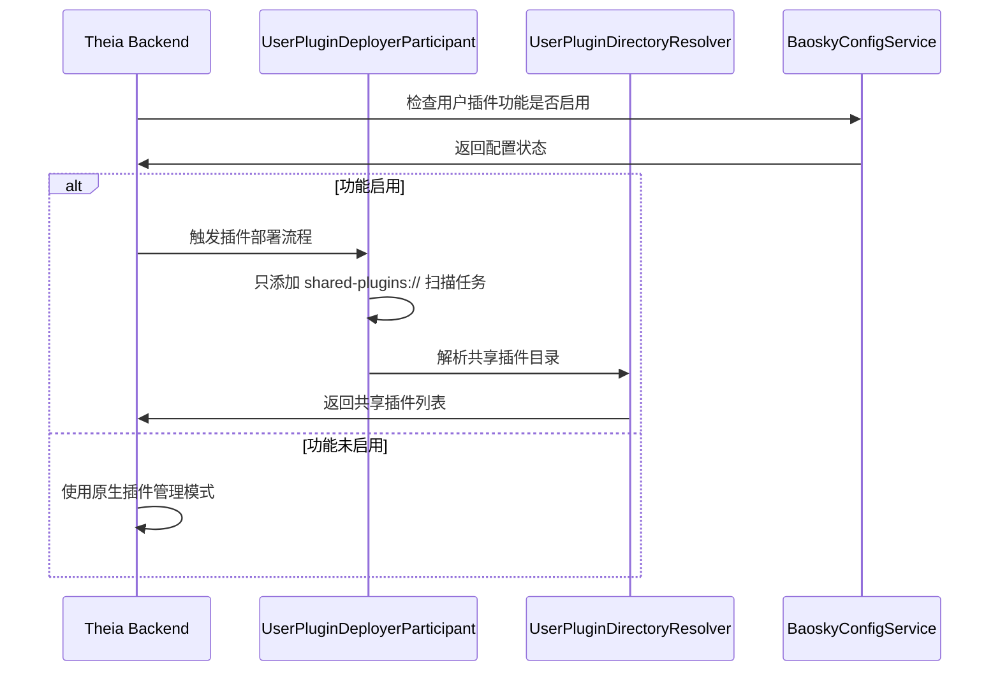
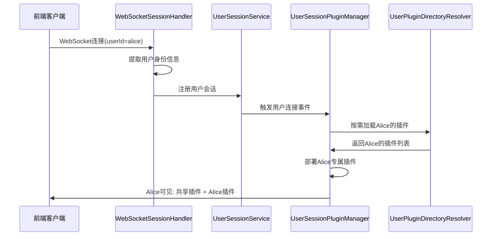
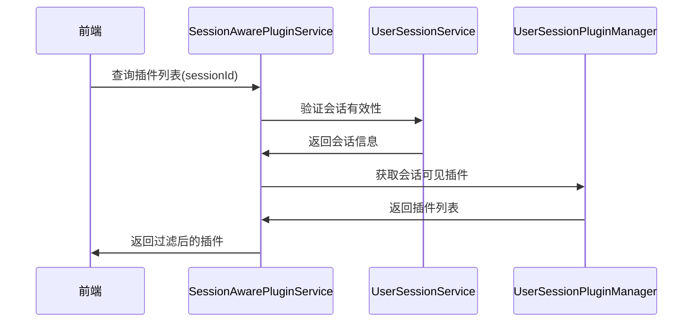

# 插件用户作用域架构说明

## 概述

Theia插件用户作用域系统实现了基于用户会话的插件隔离，确保不同用户只能访问其专属插件和共享插件，避免了传统方式下所有用户共享全部插件的问题。

## 核心理念

- **会话级插件加载**：插件不再在启动时全量加载，而是根据用户连接时按需加载
- **用户插件隔离**：每个用户只能看到自己的插件 + 共享插件
- **动态插件管理**：支持用户连接/断开时动态加载/卸载插件

## 架构组件

### 1. 核心服务层

#### UserSessionService
```typescript
// 位置: packages/plugin-ext/src/main/node/user-plugin-management/user-session-service.ts
// 职责: 管理用户会话生命周期
```
- 注册/注销用户会话
- 跟踪活跃会话状态
- 管理会话相关的用户信息（userId、isAdmin等）

#### UserSessionPluginManager
```typescript
// 位置: packages/plugin-ext/src/main/node/user-plugin-management/user-session-plugin-manager.ts
// 职责: 会话级插件生命周期管理
```
- 监听用户连接/断开事件
- 按需加载用户专属插件
- 缓存和管理会话插件状态
- 提供插件部署/卸载功能

#### SessionAwarePluginService
```typescript
// 位置: packages/plugin-ext/src/main/node/user-plugin-management/session-aware-plugin-service.ts
// 职责: 提供会话感知的插件查询和操作接口
```
- 根据会话ID查询可见插件
- 插件权限检查和访问控制
- 插件命令执行和状态管理
- 插件搜索和统计功能

### 2. 连接管理层

#### WebSocketSessionHandler
```typescript
// 位置: packages/plugin-ext/src/main/node/user-plugin-management/websocket-session-handler.ts
// 职责: WebSocket连接监控和会话管理
```
- 监听WebSocket连接建立/断开
- 从请求中提取用户身份信息
- 触发会话注册/注销流程
- 集成到Theia的WebSocket验证系统

### 3. 插件部署层

#### UserPluginDeployerParticipant
```typescript
// 位置: packages/plugin-ext/src/main/node/user-plugin-management/user-plugin-deployer-participant.ts
// 职责: 插件部署流程参与者
```
- **修改点**: 仅在启动时添加共享插件扫描
- 移除了启动时的用户插件全量扫描
- 支持按需触发特定用户插件扫描

#### UserPluginDirectoryResolver
```typescript
// 位置: packages/plugin-ext/src/main/node/user-plugin-management/user-plugin-directory-resolver.ts
// 职责: 插件目录解析器
```
- **修改点**: 新增按需解析方法
- `resolveUserPluginsOnDemand(userId)`: 解析特定用户插件
- `resolveSharedPluginsOnDemand()`: 解析共享插件
- 保持原有的全量扫描能力（向下兼容）

### 4. 配置管理层

#### BaoskyConfigService
```typescript
// 位置: packages/plugin-ext/src/main/common/baosky-config-service.ts
// 职责: 配置服务接口定义
```

#### BaoskyConfigServiceImpl
```typescript
// 位置: packages/plugin-ext/src/main/node/baosky-config-service-impl.ts
// 职责: 配置服务实现
```
- 读取用户插件管理功能开关
- 管理用户权限配置
- 处理配置文件解析

## 目录结构

```
/root/.theia/plugins/
├── shared/                          # 共享插件目录
│   └── shared-theme-plugin/         # 所有用户可见
├── users/                           # 用户插件目录  
│   ├── alice/                       # Alice的专属插件
│   │   └── alice-personal-plugin/
│   ├── bob/                         # Bob的专属插件
│   │   └── bob-dev-tools/
│   └── {userId}/                    # 其他用户目录
```

## 工作流程

### 1. 系统启动流程


### 2. 用户连接流程


### 3. 插件查询流程


## 关键特性

### 1. 按需加载
- 启动时只加载共享插件
- 用户连接时动态加载个人插件
- 用户断开时自动卸载个人插件

### 2. 权限隔离  
- 用户只能访问自己的插件
- 管理员可以访问所有插件
- 共享插件对所有用户可见

### 3. 会话管理
- 支持多用户同时连接
- 自动处理连接断开清理
- 会话状态实时跟踪

### 4. 向下兼容
- 可通过配置开关启用/禁用
- 禁用时回退到原生插件管理
- 保持现有API兼容性

## 配置说明

### 环境变量
- `THEIA_USER_PLUGINS_ENABLED=true`: 启用用户插件管理功能
- `THEIA_CURRENT_USER=userId`: 指定当前用户ID（fallback机制）

### 配置文件
```ini
# /etc/baosky.ini
[user_plugins]
enabled=true
admin_users=root,admin

[directories]
shared_plugins=/root/.theia/plugins/shared
user_plugins=/root/.theia/plugins/users
```

## 用户身份识别

系统支持多种用户身份识别方式（按优先级排序）：

1. **URL参数**: `?userId=alice`
2. **请求头**: `X-User-ID: alice`
3. **Cookie**: `theia-user-id=alice`
4. **环境变量**: `THEIA_CURRENT_USER=alice`
5. **服务器模型**: 使用ServerModel的当前用户

## 测试场景

### 预期行为
- **Alice用户连接**: 可见 `shared-theme-plugin` + `alice-personal-plugin`
- **Bob用户连接**: 可见 `shared-theme-plugin` + `bob-dev-tools`
- **多用户同时连接**: 每个用户独立的插件视图

### 验证方法
1. 使用不同的userId参数打开多个浏览器标签页
2. 检查每个用户的插件列表
3. 验证插件命令的可见性和执行权限

## 技术优势

1. **性能优化**: 避免启动时加载所有用户插件
2. **内存节省**: 只加载当前活跃用户的插件
3. **安全隔离**: 用户无法访问他人的私有插件
4. **可扩展性**: 支持动态添加新用户和插件
5. **灵活配置**: 支持运行时开启/关闭功能